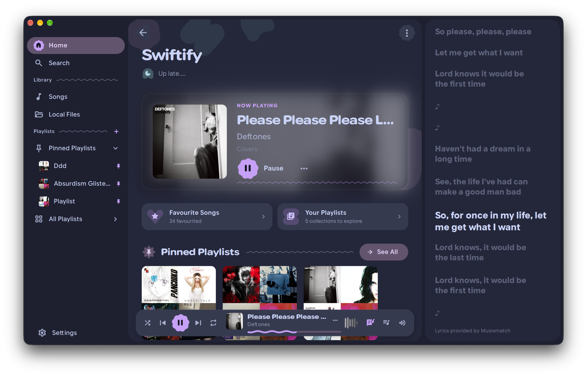
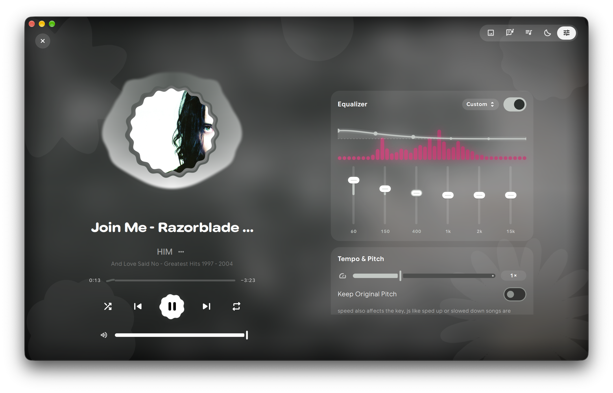
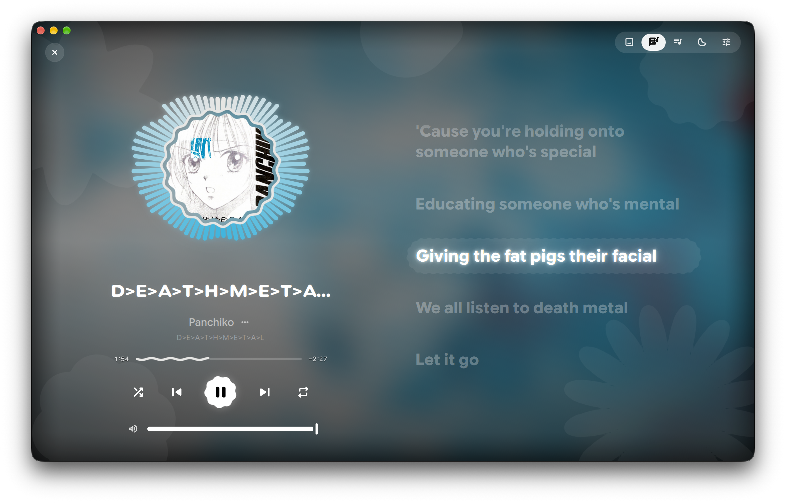

<div align="center">


# Tubify

**YouTube Music, without the browser.**

A native desktop client built with Qt Quick and a Rust core.

[](https://www.qt.io)
[](ytmusic-core)
[](LICENSE)

**[install](#install) · [build](#build) · [first run](#first-run) · [last.fm](#lastfm) · [discord](#discord) · [limits](#notes-and-limits)**



</div>

## why another one

Most YouTube Music desktop apps are a webview in a trench coat. Tubify is not.
The interface is Qt Quick, the playback engine is Rust, and the only thing the
browser does is help you sign in.

It started as a fork of [Swiftify](https://github.com/swiftify-org/swiftify),
keeping its Material 3 Expressive shell and replacing the Spotify backend with
YouTube Music. The equalizer, immersive player, synced lyrics, visualizers,
local files, stats and queue are all still here.

There is no Spotify Premium requirement, no Spotify client ID, and no Spotify
account. A normal YouTube Music account is enough.

<table>
  <tr>
    <td></td>
    <td></td>
  </tr>
  <tr>
    <td align="center">equalizer, tempo and pitch</td>
    <td align="center">immersive player with the visualizer and lyrics</td>
  </tr>
</table>

## what you get

- Home, search, liked songs, playlists, albums and artist pages from your own
  YouTube Music account
- Playlist editing: create, rename, describe, add, remove, reorder, delete
- Synced lyrics from LRCLIB, with YouTube Music's lyrics as a fallback
- Immersive player, queue, sleep timer and crossfade
- Equalizer, tempo/pitch, preamp and volume normalization
- Visualizers and the living backdrop
- Local files with tag editing and local playlists
- Listening stats from stats.fm, Last.fm, or the plays kept on this computer
- Last.fm scrobbling, connected from Settings
- Discord rich presence and MPRIS
- A **DNS resolver** switch in Settings that keeps sponsored shelves and
  promoted placements out of the library answers

The player and song rows use Deezer artwork when it is available, and fall
back to YouTube Music's own artwork. The Last.fm rows do the same.

Tubify is unofficial and is not affiliated with YouTube or Google.

## before you start

- **A YouTube Music account.** Free is fine. No Premium and no developer app.
- **A way to sign in.** The setup screen can read the login from Helium,
  Chromium, Chrome, Brave or Firefox. If that does not work, you can paste the
  `Cookie` header by hand.
- **`yt-dlp` and `ffmpeg`.** Playback downloads through `yt-dlp` and decodes
  with `ffmpeg`. Without them the app still browses your library, but it cannot
  fetch a song.
- **Optional: Last.fm.** Reading stats needs only a username. Scrobbling needs
  a one-time connect in Settings.

## install

There are no public packages yet. Build it from source for now.

<details>
<summary><b>Linux</b></summary>
<br>

Build with the Linux commands below. The repo ships a `.desktop` file and
icons in `packaging/`. Install the binary somewhere on your `PATH` and copy
`packaging/tubify.desktop` to `~/.local/share/applications/`.

The audio core uses ALSA, and the device monitor uses PulseAudio. Almost every
desktop already has both.

</details>

<details>
<summary><b>macOS</b></summary>
<br>

Build the `.app` with the macOS commands below. It is not notarized, so macOS
will block the first launch. Open **System Settings → Privacy & Security** and
choose **Open Anyway**, or run:

```sh
xattr -dr com.apple.quarantine /Applications/Tubify.app
```

</details>

<details>
<summary><b>Windows</b></summary>
<br>

Build with MSVC and package with CPack. The exe is not signed, so SmartScreen
may show “Windows protected your PC”. Choose **More info → Run anyway**.

Keep `yt-dlp.exe` and `ffmpeg.exe` next to the executable or on `PATH`.

</details>

## build

### what you need

- Qt **6.10 or newer** (Core, Gui, Network, Concurrent, Qml, Quick,
  QuickControls2, ShaderTools)
- CMake 3.24+, a C++20 compiler, Rust 1.85+
- [QCoro](https://github.com/qcoro/qcoro) 0.10+ (fetched automatically if it is
  not installed)
- `yt-dlp` and `ffmpeg` on `PATH` for playback
- Linux: `libpulse` for the audio-device monitor and ALSA for the core
- macOS: Xcode command line tools and CoreAudio, which Qt and `cpal` use
- Windows: Visual Studio 2022 with the C++ workload; WASAPI through `cpal`

The Material Symbols and Google Sans Flex fonts are downloaded at configure
time. Turn that off with `-DSWIFTIFY_DOWNLOAD_ICON_FONT=OFF` and
`-DSWIFTIFY_DOWNLOAD_INTERFACE_FONT=OFF` if you would rather supply them
yourself.

### Linux

```sh
cmake -S . -B build -DCMAKE_BUILD_TYPE=Release
cmake --build build -j"$(nproc)"
./build/swiftify
```

On Arch:

```sh
sudo pacman -S qt6-base qt6-declarative qt6-shadertools qt6-tools \
  alsa-lib libpulse cmake ninja rust yt-dlp ffmpeg
```

If Qt or QCoro live in a custom prefix:

```sh
cmake -S . -B build -DCMAKE_BUILD_TYPE=Release \
  -DCMAKE_PREFIX_PATH="$HOME/.local"
```

### macOS

```sh
cmake -S . -B build -DCMAKE_BUILD_TYPE=Release
cmake --build build --config Release -j"$(sysctl -n hw.ncpu)"
open build/Tubify.app
```

If Qt is installed with Homebrew, add its prefix:

```sh
cmake -S . -B build -DCMAKE_BUILD_TYPE=Release \
  -DCMAKE_PREFIX_PATH="$(brew --prefix qt)"
```

To make a distributable disk image:

```sh
cmake --build build --config Release
cpack --config build/CPackConfig.cmake -G DragNDrop
```

Signing and notarization are optional. See `packaging/macos/` for the bundle
metadata and entitlements.

### Windows

Use a Developer PowerShell and a 64-bit MSVC generator:

```powershell
cmake -S . -B build -G "Visual Studio 17 2022" -A x64
cmake --build build --config Release
```

The executable is `build\Release\swiftify.exe` for now. Package it with the Qt
runtime and the installer:

```powershell
cpack --config build/CPackConfig.cmake -G NSIS
```

`yt-dlp.exe` and `ffmpeg.exe` still need to be on `PATH`, or placed next to the
executable. The installer can bundle them.

## first run

Tubify needs a YouTube Music account. There are two ways to give it one.

### read the login from your browser

This is the easy one. Open YouTube Music in a browser where you are already
signed in, then choose that browser on Tubify's setup screen:

**Helium · Chromium · Chrome · Brave · Firefox**

Tubify reads the cookie from that browser's own profile with `yt-dlp`. Close
the browser first if its cookie database is locked. Nothing is uploaded; the
cookie is kept on this computer and used for YouTube Music requests.

### paste the cookie yourself

1. Open [music.youtube.com](https://music.youtube.com) and sign in.
2. Press `F12`, open **Network**, and reload the page.
3. Click a request to `music.youtube.com`.
4. Copy the whole **Cookie** request header.
5. Paste it into Tubify's setup screen and choose **Sign In**.

The login is kept in Tubify's app-data folder, readable only by your user.
Nothing is sent anywhere except to YouTube Music.

## last.fm

The stats page can read a public Last.fm profile with just a username. It uses
a shared app key, so there is no API key to create.

To send plays to Last.fm:

1. Open **Settings → Listening Stats**.
2. Choose **Last.fm**.
3. Click **Connect Last.fm**, approve Tubify in the browser, then click
   **I Approved**.
4. Turn on **Scrobble plays to Last.fm**.

Scrobbles are sent when a play is recorded (after 30 seconds or half the
track). Last.fm itself can take a minute or two to show them.

## discord

Rich presence is one toggle in Settings. It uses a shared Discord app, so you
do not need to create an application or paste an ID. The song, artist, progress
and album art are shared while something is playing.

## if something breaks

- **The browser login does nothing.** Close the browser completely, then try
  again. Chromium-based browsers lock their cookie database while they run.
- **Playback says it cannot fetch the song.** Check that `yt-dlp` and `ffmpeg`
  are the system binaries, not an old pipx copy. `yt-dlp --version` should be
  recent enough to know YouTube's current player.
- **A song 403s once and then works.** YouTube occasionally rotates a stream.
  Retrying usually fixes it.
- **Scrobbles are late.** Tubify sends them as soon as a play is recorded;
  Last.fm's own ingest can lag by a minute or two.
- **Discord artwork is missing.** Discord does not always accept external
  artwork URLs. The track, artist and progress should still show.
- **macOS says the app is damaged.** It is the quarantine flag, not a broken
  build. Use the `xattr` command above.

## notes and limits

- YouTube Music does not let an app set a playlist's own cover, so that action
  reports that instead of pretending to work.
- Artist genres are not published by YouTube Music. The stats page shows the
  artist without a genre instead of guessing.
- Playback needs `yt-dlp` and `ffmpeg`. Without them the app still browses the
  library but cannot fetch a song.
- YouTube Music tops out at 256 kbps. There is no lossless or "HD audio" tier.
  The quality setting is Normal (128), High (256), or Best available.
- Closing the window quits by default. Turn on **Keep running in background**
  in Settings if you want it to hide and keep playing.

## credits

Tubify is a fork of [Swiftify](https://github.com/swiftify-org/swiftify) by
shred0s, which is GPL-3.0. The Material 3 tokens, motion and shapes come from
end4. The Rust core keeps Swiftify's audio pipeline, equalizer, analyser and
local-file playback.

Last.fm's shared read key comes from MusicBrainz Picard; the shared scrobbling
key comes from Last.fm Desktop. Both are GPL projects. Deezer provides the
artwork fallback.

## license

GPL-3.0. See [LICENSE](LICENSE).
